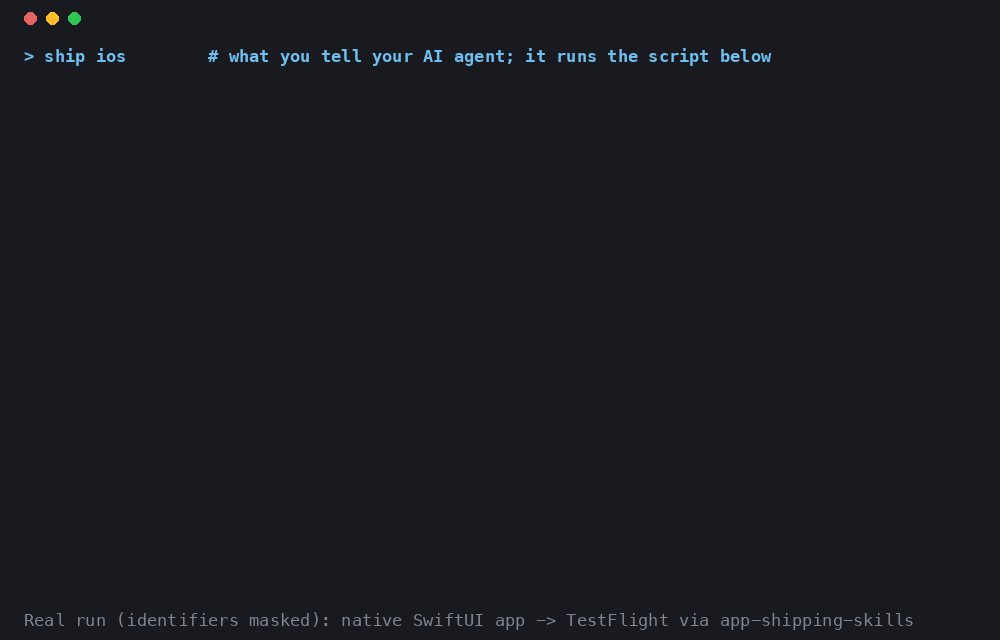

# app-shipping-skills

Ship a mobile app from your AI coding agent: build with your own toolchain, upload to TestFlight, submit for App Store review, publish to Google Play, and set up AdMob — without opening the store consoles.

Skills for [Claude Code](https://claude.com/claude-code) and any agent that supports the [Agent Skills](https://agentskills.io) format. Extracted from the workflow used to ship 40+ apps.

> Not affiliated with Apple, Google, or Anthropic.



*A real run of the iOS path on a native SwiftUI app, identifiers masked. The Xcode build output is omitted from the recording.*

## Why this exists

Store submission fails in ways the docs don't warn you about. These skills carry the fixes, so the agent doesn't rediscover them one rejected build at a time:

| You hit | Cause | Handled by |
|---|---|---|
| ITMS-90087 / 90086 / 90203 / 91169 on upload | simulator (x86_64) slices left in the IPA by a cached build | `ios-testflight-upload` verifies the IPA before uploading |
| ITMS-90189 Redundant Binary | build number already uploaded | version check before building |
| Build "uploaded" but no IPA on disk | export options set to `destination: upload` | disk-export plist generated for you |
| Play rejects the AAB: Billing Library < 8.0, target SDK too low, version code already used | store policy changes | `android-playstore-submit` hints per error |
| Play upload blocked by the child-safety declaration | account-level declaration, not a build problem | documented with the exact menu path |
| App Store header image rejected | transparency in the PNG | `app-store-header-image` checks and fixes it |
| `asc` command missing or failing | outdated `asc` | version check, upgrade hint |

## What you get

| Skill | Say | Does |
|---|---|---|
| `ship` | "ship ios", "ship android", "ship all" | Runs the pipeline below, stopping for confirmation before anything irreversible |
| `ios-testflight-upload` | "upload to TestFlight" | build → `altool` upload, with the known ITMS-90087 / ITMS-90189 failures handled |
| `ios-appstore-submit` | "submit to the App Store" | Checks the version state, creates the App Store version, runs preflight checks, submits for review |
| `android-playstore-submit` | "release to Google Play" | build → fastlane supply, with the Play Billing 8.0 and child-safety declaration blockers documented |
| `app-store-header-image` | "upload the App Store header image" | Product page header / creative assets via the Asset Library (new in Oct 2026, few docs) |
| `admob` | "register the app in AdMob", "create ad units" | AdMob API CLI: register the app, create ad units, hand you the IDs to paste |

No daemons. Each skill is Markdown plus bash or dependency-free Python.

## Install

Claude Code:

```bash
/plugin marketplace add kotaroyamazaki/app-shipping-skills
/plugin install app-shipping-skills
```

Any other agent: copy `skills/*` into your agent's skills directory.

## Setup (once per machine)

- iOS: [docs/setup-ios.md](docs/setup-ios.md) — `brew install asc`, an App Store Connect API key
- Android: [docs/setup-android.md](docs/setup-android.md) — fastlane, a Play service account invited to your app
- AdMob: [docs/setup-admob.md](docs/setup-admob.md) — your own Google Cloud project and OAuth client (5 minutes). The consent screen stays in *Testing* mode, so you re-authorize in the browser about once a week; the CLI prompts you when that happens.

## Setup (once per app)

Put a `ship.env` in the app's root (see [ship.env.example](ship.env.example)). The `ship` skill creates it for you by reading the Xcode / Gradle project when it is missing.

```
IOS_BUNDLE_ID=com.example.myapp
IOS_APP_ID=1234567890
IOS_TEAM_ID=ABCDE12345
ANDROID_PACKAGE=com.example.myapp
PLAY_SERVICE_ACCOUNT_JSON=~/.config/app-shipping/play-service-account.json
ADMOB_PUBLISHER_ID=pub-9876543210987654
```

`ship.env` holds no secrets. Keys live in `~/.config/app-shipping/`.

How the app gets built is up to you. Optional keys tell the upload scripts which command to run and where the artifact lands (`IOS_BUILD_CMD` / `IOS_IPA_PATH`, `ANDROID_BUILD_CMD` / `ANDROID_AAB_PATH`, plus optional clean commands and `VERSION_NAME` / `BUILD_NUMBER`). Point the `*_PATH` keys at an IPA or AAB built elsewhere to skip the build. Values for common toolchains: [docs/build-recipes.md](docs/build-recipes.md).

## Example

Illustrative transcript (not captured from a real run):

```
> ship ios

Version 1.4.0 (12) is not yet on App Store Connect. Building IPA… uploaded to TestFlight.
Created App Store version 1.4.0. Preflight: metadata ✓, screenshots ✓, export compliance ✓.
Submit 1.4.0 for review now? (yes/no)
```

## What has been verified

Run end to end by the author against real stores: the iOS path (build with Flutter or native Xcode, arm64 check, TestFlight upload) and the AdMob read APIs. Written from working experience but not re-run for this release: the Android / Google Play script, the App Store submission steps, the header image tooling, and the Gradle build recipe. If one breaks for you, please open an issue with the error output.

## What it will not do

- Create your Apple Developer / Play / AdMob accounts, or accept agreements for you
- Delete or rename AdMob apps and ad units (the API has no such methods)
- Bypass store review

## Contributing

Gotchas are the most valuable part of this repository. If a submission failed for a reason not documented here, open an issue with the error code and what fixed it.

## License

MIT
